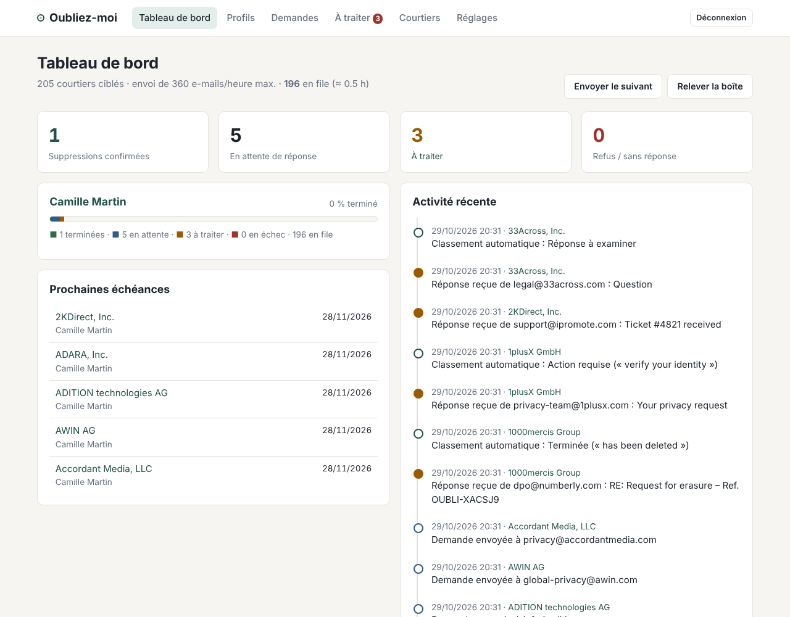
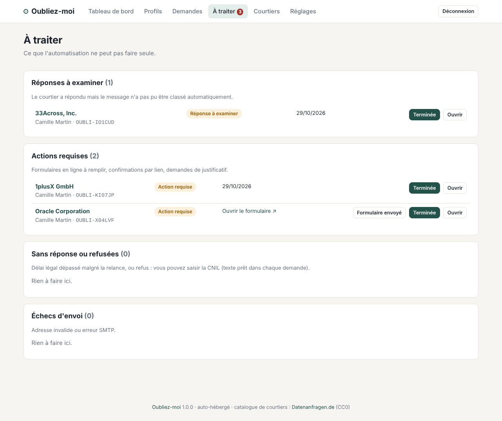
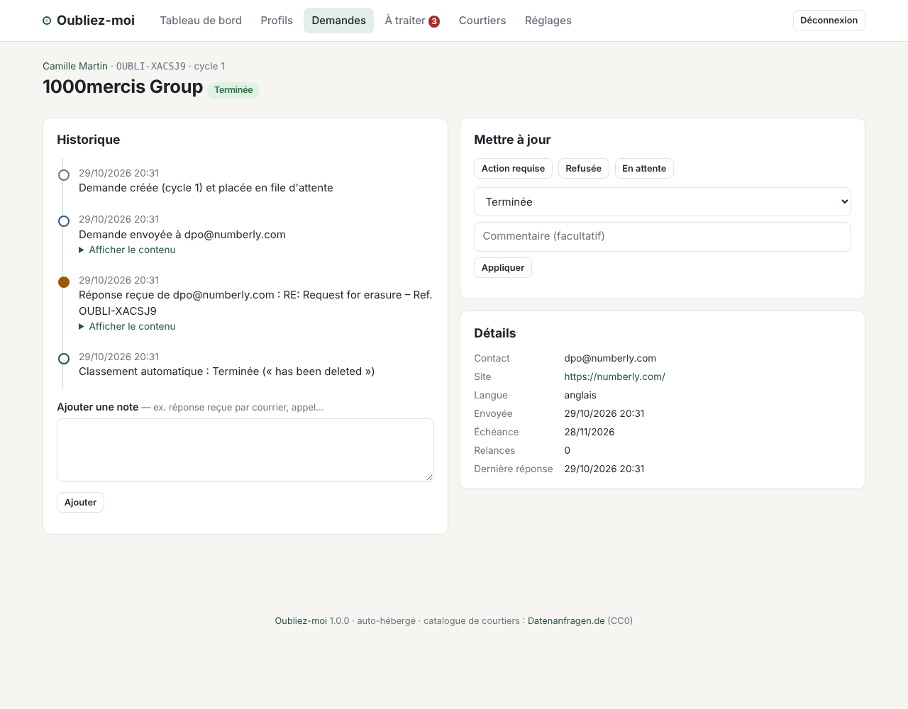

# Oubliez-moi

**Une alternative auto-hébergée à Incogni.** Oubliez-moi envoie en votre nom des demandes d'effacement RGPD aux courtiers en données, suit leurs réponses, relance quand ils ne répondent pas et recommence périodiquement, le tout depuis votre propre serveur et votre propre boîte mail.



## Ce que fait Oubliez-moi

| | |
|---|---|
| **Catalogue de ~370 courtiers** | Courtiers d'adresses, plateformes publicitaires et DMP, bureaux de crédit, bases de prospection B2B… issus de la base ouverte [Datenanfragen.de](https://github.com/datenanfragen/data) (CC0). Environ 200 sont activés par défaut pour un résident français (courtiers français et internationaux). Mise à jour automatique tous les 30 jours. |
| **Demandes juridiquement solides** | Effacement (art. 17), opposition à la prospection (art. 21), notification aux destinataires (art. 19) et délai d'un mois (art. 12.3). En français pour les courtiers français, en anglais sinon. |
| **Envoi lissé** | 30 e-mails par heure par défaut, pour ne pas être considéré comme du spam par votre fournisseur. |
| **Relève automatique des réponses** | Via IMAP en lecture seule. Chaque e-mail porte une référence unique (`OUBLI-XXXXXX`) qui permet de rattacher les réponses. Elles sont classées automatiquement (données supprimées, aucune donnée, justificatif demandé, accusé de réception, non-distribution) en français, anglais et allemand. |
| **Relances, mise en demeure et CNIL** | Une relance part automatiquement à l'expiration du délai légal, puis une mise en demeure. Sans réponse, la demande passe « sans réponse » et Oubliez-moi prépare un dossier de réclamation complet à imprimer en PDF (exposé des faits, chronologie, courriers et réponses) pour la CNIL. |
| **Réponses automatiques** | Pièce d'identité exigée, refus au nom de l'« intérêt légitime », question sur le pays de résidence : Oubliez-moi répond seul avec le bon argument juridique (une fois par motif, trois réponses au maximum par courtier). Les prolongations de délai sont prises en compte. |
| **Liens de confirmation** | Les liens « confirmez votre demande » sont ouverts automatiquement (désactivable) : seulement sur le domaine du courtier ou une plateforme RGPD connue, jamais un lien d'annulation ni un lien de désinscription ou une adresse du réseau local. Les redirections sont suivies une à une (5 au maximum) et chaque étape est revérifiée. |
| **IA locale (facultatif)** | Un modèle qui tourne chez vous avec Ollama classe et résume les réponses que les mots-clés ne comprennent pas. Rien n'est envoyé à un service externe. |
| **Boîte mail rangée** | Les réponses des courtiers sont déplacées dans un dossier (ou libellées sur Gmail) et peuvent être marquées comme lues. |
| **Boîtes mail (séparé)** | Ajoutez vos boîtes (Gmail, Hotmail/Outlook, Proton, iCloud, autre IMAP) : Oubliez-moi repère qui vous écrit en masse, vous désabonne en un clic quand l'expéditeur le permet, et range leurs e-mails dans un dossier. Seuls les en-têtes sont lus. La boîte déjà configurée dans les réglages y figure d'office (sans copier son mot de passe) ; rien n'y est lu avant que vous lanciez l'analyse. |
| **Données protégées** | Mots de passe et jetons chiffrés dans la base ; sauvegardes automatiques et chiffrées vers votre pool. |
| **Notifications** | ntfy, Gotify ou récapitulatif quotidien par e-mail, uniquement quand une décision vous attend. |
| **Renvoi périodique** | Comme Incogni : 90 jours après une suppression confirmée, la demande est renvoyée, parce que les courtiers recollectent les données. |
| **Plusieurs profils** | Pour vous et vos proches (avec leur accord). |
| **Page « À traiter »** | Les réponses à examiner, les actions requises, les délais dépassés et les échecs, dans une boîte de traitement : liste à gauche, message à droite, une décision en un clic (ou une touche du clavier) et passage automatique au suivant. |
| **Lecture des e-mails** | Les réponses s'affichent avec leur mise en forme d'origine, nettoyées et isolées : scripts, formulaires, images et contenus distants sont bloqués, les pixels de pistage ne peuvent donc pas signaler que vous avez lu le message. Le message cité est replié. |
| **Aide aux formulaires** | Pour les courtiers qui n'acceptent que leur formulaire en ligne : chaque information prête à copier en un clic (nom, prénom, e-mails, téléphones aux deux formats, adresse découpée), message de demande en français et en anglais, et délai d'un mois qui démarre quand vous confirmez l'envoi. |
| **Compléments** | Vous ajoutez une adresse e-mail, un téléphone ou une ancienne adresse au profil après l'envoi ? Oubliez-moi repère les courtiers qui ne l'ont pas reçue et leur envoie un complément sous la même référence. |
| **Protection de vos comptes** | Les organismes chez qui vous avez peut-être un vrai compte (instituts de panels, outils de prospection professionnels, cashback et affiliation, avis clients) sont signalés avant l'envoi, pour que vous puissiez les exclure. |
| **Dossiers RGPD** | Pour les autres droits (accès, rectification, portabilité…) auprès de n'importe quel organisme : suivi des délais (un mois, prolongeable de deux), assistant de rédaction et export des preuves. Les dossiers en retard apparaissent dans « À traiter » et sur le tableau de bord, et sont notifiés une fois par échéance. |
| **Migration vers Proton** | Liste des services qui écrivent à vos anciennes adresses Gmail ou Hotmail, création de leur alias Proton Pass en un clic (API SimpleLogin) et suivi jusqu'à ce que chacun écrive à son alias. |
| **Export CSV** | L'historique complet, utile comme preuve. |

<p align="center"> </p>

## Installation (Ubuntu + Docker)

Prérequis : un serveur avec [Docker Engine et le plugin Compose](https://docs.docker.com/engine/install/ubuntu/).

```bash
git clone https://github.com/oliv2776/Oubliez-moi.git
cd Oubliez-moi
cp .env.example .env
nano .env            # au minimum : ADMIN_PASSWORD
docker compose up -d --build
docker compose logs -f
```

Par défaut, l'interface écoute sur `http://127.0.0.1:27480`, accessible uniquement depuis le serveur lui-même.

**Accès depuis le réseau local** : mettez `BIND_ADDRESS=0.0.0.0` (ou l'IP du serveur) dans `.env`, puis `docker compose up -d`. L'interface est alors joignable sur `http://IP-DU-SERVEUR:27480`. Si le pare-feu UFW est actif, sachez que Docker publie ses ports sans passer par lui : n'exposez pas ce port sur une IP publique, et limitez l'accès au réseau local ou au VPN.

**Accès distant** : utilisez un reverse proxy HTTPS (voir plus bas) ou un tunnel SSH :

```bash
ssh -L 27480:127.0.0.1:27480 utilisateur@mon-serveur   # puis ouvrez http://localhost:27480
```

### Image prête à l'emploi

Le workflow GitHub Actions construit et publie l'image (amd64 et arm64) sur `ghcr.io/oliv2776/oubliez-moi` à chaque push sur `main`. Pour l'utiliser sans compiler sur le serveur, remplacez `build: .` par `image: ghcr.io/oliv2776/oubliez-moi:latest` dans `docker-compose.yml`. Si le dépôt est privé, rendez le paquet public dans les réglages GitHub ou faites un `docker login ghcr.io`.

## Configuration de la messagerie

Tout se fait dans l'interface, page **Réglages** : adresse e-mail, mot de passe, serveurs d'envoi (SMTP) et de relève (IMAP). Des préréglages remplissent les serveurs pour Gmail, iCloud, OVH, Orange, Free et La Poste. Le bouton **Envoyer un e-mail de test** vérifie la configuration.

Utilisez de préférence **une adresse dédiée** (par exemple `rgpd.prenom@…`). Les courtiers y répondront, et votre boîte principale ne sera pas noyée.

- **Gmail** : il faut un [mot de passe d'application](https://myaccount.google.com/apppasswords) (validation en deux étapes activée). Le mot de passe habituel est refusé.
- **iCloud** : il faut un mot de passe pour app, à créer sur account.apple.com.
- **Outlook.com / Hotmail** : Microsoft impose désormais une connexion OAuth aux logiciels tiers, que l'outil ne gère pas. Préférez une autre adresse.
- Ajoutez le dossier spam aux dossiers surveillés (Gmail : `INBOX, [Gmail]/Spam`). Les réponses de courtiers y finissent souvent.
- **Authentification des réponses** (onglet *Relève des réponses*) : cliquez sur **Enregistrer et détecter automatiquement**. Oubliez-moi lit les en-têtes des derniers messages reçus et retient l'identifiant de votre serveur (`mx.google.com` pour Gmail). Sans lui, les réponses sont classées mais aucune ne clôture une demande toute seule ; un bandeau le rappelle sur le tableau de bord.

Les réglages saisis dans l'interface sont enregistrés dans la base (volume Docker) et prennent le pas sur le fichier `.env`.

## Premier lancement

1. Connectez-vous avec `ADMIN_USER` / `ADMIN_PASSWORD`.
2. Dans **Réglages**, configurez votre adresse e-mail, enregistrez, puis envoyez un e-mail de test.
3. Créez votre profil (nom, toutes vos adresses e-mail, téléphones, adresses postales actuelles et anciennes).
4. Cliquez sur **Aperçu du courrier** pour relire la lettre.
5. Dans **Réglages**, passez le mode d'envoi de « Simulation » à « Réel ».
6. Sur la page du profil, cliquez sur **Lancer les demandes**.

Vous pouvez aussi lancer les demandes en simulation pour voir le déroulé : rien ne part. Au passage en envoi réel, les demandes simulées sont automatiquement remises en file et envoyées pour de bon.

Ensuite, passez de temps en temps sur **À traiter**. Tout le reste est automatique.

## IA locale avec Ollama (facultatif)

Le service Ollama est déjà prévu dans `docker-compose.yml`, désactivé par défaut. Pour l'activer :

```bash
docker compose --profile ia up -d
```

Puis, dans **Réglages → Automatismes**, indiquez l'adresse `http://ollama:11434`, choisissez un modèle dans la liste et cliquez sur « Télécharger ce modèle » : la progression s'affiche dans la page. « Enregistrer et tester le modèle » vérifie ensuite que tout fonctionne.

| Modèle | Type | Mémoire | Pour qui |
|---|---|---|---|
| **Tev1 4B** (`tev1:4b`) | décision | ~3 Go | **Recommandé** : précis et léger |
| Nimble 9B (`nimble`) | décision | ~7 Go | Le plus précis, plus lent sur processeur |
| Tev1 0.8B (`tev1:0.8b`) | décision | ~1 Go | Très petites machines, moins fiable |
| Qwen2.5 3B / 7B, Qwen3 4B / 8B | conversationnel | 2,5 à 6 Go | Si vous voulez un résumé en une phrase de chaque réponse |

Un **modèle de décision** choisit une catégorie dans la liste et donne une probabilité, en une seule passe : c'est plus rapide et plus fiable pour ce travail, mais il n'écrit pas de texte. Un **modèle conversationnel** classe et résume la réponse. Dans les deux cas, la décision n'est appliquée que si sa probabilité atteint 70 % ; le numéro de dossier du courtier est repéré dans le texte. Tout autre modèle Ollama peut être indiqué avec « Autre modèle… ». La même page liste les modèles installés avec leur taille et permet de supprimer ceux qui ne servent plus, pour récupérer de la place. Les modèles de décision nécessitent Ollama 0.35 ou plus récent (`docker compose pull ollama`).

Seules les réponses que les mots-clés ne savent pas classer sont analysées, quelques-unes par semaine : une analyse prend de quelques secondes à une minute sur processeur, ce qui est sans importance ici. Rien ne quitte votre serveur.

Le service est bridé pour ne pas gêner le reste du serveur : 4 cœurs au plus, priorité basse, 8 Go de mémoire maximum, et le modèle est déchargé de la mémoire après 5 minutes d'inactivité. Ajustez `cpus` et `mem_limit` dans `docker-compose.yml` si besoin.

Si Ollama tourne déjà ailleurs sur votre réseau, indiquez simplement son adresse (par exemple `http://192.168.1.20:11434`).

**Ollama installé directement sur le serveur** (script `curl -fsSL https://ollama.com/install.sh | sh`) : il n'écoute alors que sur `127.0.0.1`, que le conteneur ne peut pas joindre. Faites-le écouter sur le réseau et gardez les mêmes limites que le service Docker avec `sudo systemctl edit ollama` :

```ini
[Service]
Environment="OLLAMA_HOST=0.0.0.0:11434"
Environment="OLLAMA_KEEP_ALIVE=5m"
Environment="OLLAMA_NUM_PARALLEL=1"
Environment="OLLAMA_MAX_LOADED_MODELS=1"
CPUQuota=400%
MemoryMax=8G
Nice=10
```

puis `sudo systemctl restart ollama`, et indiquez l'adresse `http://host.docker.internal:11434` dans les réglages. Ollama n'a pas de mot de passe : avec `ufw`, n'ouvrez le port qu'aux conteneurs (`sudo ufw allow from 172.16.0.0/12 to any port 11434 proto tcp`). N'activez pas en plus le profil `ia`.

## Boîtes mail : désinscriptions et rangement

Rubrique **Boîtes mail**, indépendante des demandes aux courtiers. Ajoutez autant de boîtes que vous voulez ; chacune a ses propres identifiants, chiffrés dans la base.

| Fournisseur | Connexion |
|---|---|
| Gmail | `imap.gmail.com`, mot de passe d'application Google |
| iCloud | `imap.mail.me.com`, mot de passe pour app |
| Proton Mail | Via [Proton Mail Bridge](https://proton.me/mail/bridge) (offre payante), par exemple en conteneur (`shenxn/protonmail-bridge`) ; adresse du Bridge, port 1143, STARTTLS, certificat non vérifié (auto-signé), identifiants affichés par la commande `info` du Bridge |
| Hotmail / Outlook.com | Microsoft n'accepte plus de mot de passe en IMAP depuis septembre 2024. Après l'ajout de la boîte, cliquez sur « Connecter le compte Microsoft » et saisissez le code affiché sur microsoft.com/devicelogin : Oubliez-moi utilise l'identifiant d'application du projet, comme Apple Mail ou Thunderbird utilisent le leur. Pour utiliser le vôtre (fork, Microsoft 365 d'entreprise), indiquez-le dans la boîte ou dans `MS_CLIENT_ID` ; la marche à suivre est rappelée dans le formulaire. |
| Autre | Tout serveur IMAP |

Oubliez-moi lit uniquement les **en-têtes** (expéditeur, objet, date, liens de désinscription) : un message compte comme envoi en masse s'il porte un en-tête `List-Unsubscribe`, `List-Id` ou `Precedence: bulk`. La première analyse remonte jusqu'à 12 mois (réglable), les suivantes ne lisent que les nouveaux messages, chaque nuit.

Pour chaque expéditeur :

- **Se désinscrire** : automatique quand l'expéditeur propose la désinscription en un clic normalisée (RFC 8058) ; sinon, Oubliez-moi vous donne le lien ou l'adresse à utiliser et la ligne passe dans « Désinscription à finir ».
- **Ranger** : déplace ses e-mails dans un dossier (« Newsletters » par défaut ; sur Gmail, c'est un libellé). Rien n'est jamais supprimé.
- **Garder** : pour les lettres que vous voulez continuer à recevoir.

Un expéditeur qui écrit encore après s'être désinscrit est signalé ; ceux qui figurent dans le catalogue de courtiers aussi.

## Migrer ses comptes vers Proton (alias)

Page **Migration des comptes** : la liste des services qui écrivent encore à vos anciennes adresses (Gmail, Hotmail…), et où en est leur passage à un alias Proton.

1. **Inventaire** : choisissez les boîtes « à quitter » et lancez l'inventaire. Oubliez-moi lit deux ans d'en-têtes (expéditeur, objet, date, destinataire, jamais le contenu) et regroupe les services par domaine. Ceux qui envoient des e-mails de compte (mot de passe, sécurité, commande, facture) passent en premier. Les personnes qui vous écrivent depuis une messagerie grand public sont ignorées, comme les courtiers à qui vous avez envoyé une demande.
2. **Alias Proton Pass** : les alias de Proton Pass sont partagés avec SimpleLogin. Créez une clé d'API sur [SimpleLogin › Paramètres](https://app.simplelogin.io/dashboard/setting) (connexion avec votre compte Proton) et collez-la dans la page. Oubliez-moi relie alors chaque alias au service qui lui écrit, repère les comptes déjà migrés, et crée en un clic l'alias d'un service (préfixe = nom du service), visible ensuite dans Proton Pass. La clé est conservée chiffrée.
3. **Suivi** : un compte passe « Migré » dès que le service écrit à son alias. Il est signalé s'il écrit encore à l'ancienne adresse (autre compte, newsletter oubliée). Vous pouvez aussi marquer un compte migré à la main, « à abandonner » ou « pas un compte ». Les nouveaux e-mails et l'activité des alias sont vérifiés chaque nuit.

**Boîte Proton (facultatif)** : avec une offre Proton payante, Proton Mail Bridge permet aussi de lire la boîte Proton. Le service est prévu dans `docker-compose.yml` (image communautaire `dancwilliams/protonmail-bridge`, sans auto-mise à jour, aucun port publié) :

```bash
docker compose --profile proton run --rm protonmail-bridge init
#   dans le Bridge : login  (adresse, mot de passe, code 2FA)
#                    info   (identifiant et mot de passe IMAP à reporter dans Oubliez-moi)
#                    exit
docker compose --profile proton up -d
```

Puis **Boîtes mail › Ajouter une boîte › Proton Mail** : serveur `protonmail-bridge`, port `143`, STARTTLS, avec l'identifiant et le mot de passe affichés par `info`. Ce n'est pas votre mot de passe Proton.

## Sécurité et sauvegardes

- **Chiffrement** : les mots de passe de messagerie, les jetons de notification et les connexions des boîtes sont chiffrés dans la base (Fernet : AES + HMAC). La clé vient de `ENCRYPTION_KEY` dans `.env` (recommandé), sinon d'un fichier généré dans le volume de données ; elle n'est jamais dans les sauvegardes. Les mots de passe enregistrés par une version précédente sont chiffrés automatiquement au démarrage. Si une valeur ne peut pas être déchiffrée, elle est conservée et une erreur explicite est inscrite dans les journaux : elle n'est jamais remplacée silencieusement par une chaîne vide.
- **CSRF** : toute requête qui modifie des données doit venir de l'application elle-même : `Origin` (ou `Referer`) identique à l'adresse utilisée pour l'ouvrir ou à `APP_URL`, ou, à défaut, `Sec-Fetch-Site: same-origin` envoyé par le navigateur. Les pages sont servies avec `Referrer-Policy: same-origin` : aucun Referer ne part vers l'extérieur, mais le navigateur continue d'envoyer `Origin` à l'application (avec `no-referrer`, il enverrait `Origin: null` et plus aucun formulaire ne passerait). Renseigner `APP_URL` n'empêche pas de passer par l'IP locale.
- **DNS rebinding / SSRF** : les requêtes HTTP sortantes épinglent l'adresse IP résolue pour la connexion, refusent les IP non publiques pour les destinations non fiables et ne suivent jamais une redirection sans la revérifier (seuls les liens de confirmation en suivent, étape par étape).
- **Authentification des réponses** : pour autoriser la clôture automatique d'une demande, réglez l'identifiant du serveur qui ajoute `Authentication-Results` (Réglages › Relève des réponses, bouton de détection automatique, ou `IMAP_AUTHSERV_ID`). L'application exige un résultat DMARC pass émis par cet identifiant, avec `header.from` correspondant au domaine de `From` et un SPF (`smtp.mailfrom`) ou DKIM (`header.d`, ou `header.i` chez Gmail) réussi et aligné. Les résultats dupliqués ou non alignés sont refusés, et l'historique de la demande indique pourquoi une réponse n'a pas été retenue. Outlook/Hotmail n'écrivent pas d'identifiant : avec ces boîtes, les décisions sensibles restent manuelles.
- **Renouvellements** : les renvois automatiques sont limités à trois cycles au total par courtier et profil par défaut (cycle initial compris). Modifiez `MAX_AUTOMATIC_RESEND_CYCLES` si nécessaire ; `1` désactive tout renouvellement automatique.
- **Sauvegardes** : indiquez dans `.env` un dossier de votre pool (`BACKUP_PATH=/mnt/tank/backups/oubliez-moi`), rendez-le accessible à l'utilisateur du conteneur (`sudo chown 10001 …`), puis `docker compose up -d`. Dans **Réglages → Sécurité et sauvegardes** : fréquence (chaque nuit par défaut), nombre de sauvegardes gardées, chiffrement, bouton « Sauvegarder maintenant » et liste des sauvegardes.
- **Restauration** :

```bash
docker compose stop oubliez-moi
docker compose run --rm oubliez-moi python -m app.backup restore NOM_DU_FICHIER
docker compose start oubliez-moi
```

Conservez la clé de chiffrement hors du serveur (bouton « Afficher la clé ») : sans elle, une sauvegarde chiffrée ne peut pas être restaurée. Pour une protection complète, activez aussi le chiffrement natif ZFS sur le dataset.

## Reverse proxy HTTPS

**Caddy** (certificat Let's Encrypt automatique), dans `/etc/caddy/Caddyfile` :

```
oubliez-moi.mondomaine.fr {
    reverse_proxy 127.0.0.1:27480
}
```

**Nginx** :

```nginx
server {
    server_name oubliez-moi.mondomaine.fr;
    location / {
        proxy_pass http://127.0.0.1:27480;
        proxy_set_header Host $host;
        proxy_set_header X-Forwarded-For $proxy_add_x_forwarded_for;
        proxy_set_header X-Forwarded-Proto $scheme;
    }
    # listen 443 ssl; + certificats (certbot --nginx)
}
```

Mettez ensuite dans `.env` :

- `COOKIE_SECURE=true` ;
- `APP_URL=https://oubliez-moi.mondomaine.fr` (liens des notifications ; l'accès par l'IP locale reste possible) ;
- `FORWARDED_ALLOW_IPS` = l'adresse depuis laquelle le proxy joint le conteneur. Ce n'est **pas** `127.0.0.1` : vu du conteneur, un proxy installé sur l'hôte arrive par la passerelle du réseau Docker. Pour la connaître : `docker inspect oubliez-moi --format '{{range .NetworkSettings.Networks}}{{.Gateway}}{{end}}'`. Sans ce réglage, tous les visiteurs semblent venir de la même adresse : cinq mots de passe erronés, d'où qu'ils viennent, bloquent la connexion de tout le monde pendant 15 minutes.

L'application contient des données personnelles sensibles : ne l'exposez jamais en HTTP simple, et envisagez de la réserver à votre VPN (WireGuard, Tailscale…).

## Toutes les options

Voir [`.env.example`](.env.example), qui documente chaque variable. La messagerie se règle dans l'interface ; dans le `.env`, les plus utiles sont :

| Variable | Défaut | Rôle |
|---|---|---|
| `ADMIN_USER` / `ADMIN_PASSWORD` | `admin` / — | Accès à l'interface |
| `BIND_ADDRESS` | `127.0.0.1` | `0.0.0.0` pour un accès depuis le réseau local |
| `BROKER_COUNTRIES` | `fr,all` | Pays dont les courtiers sont activés par défaut (`all` = internationaux) |
| `RESPONSE_DAYS` | `30` | Délai avant relance |
| `REMINDER_WAIT_DAYS` | `15` | Délai après relance avant « sans réponse » |
| `RESEND_INTERVAL_DAYS` | `90` | Renvoi après confirmation (`0` = jamais) |
| `AUTO_ENROLL_NEW_BROKERS` | `true` | Contacter automatiquement les nouveaux courtiers du catalogue |
| `BROKER_AUTO_UPDATE_DAYS` | `30` | Mise à jour du catalogue (`0` = manuelle) |

## Sauvegarde et mise à jour

Toutes les données sont dans le volume Docker `oubliez-moi_oubliez-moi-data` (base SQLite `oubliez-moi.db`). Les sauvegardes automatiques sont décrites plus haut ; la commande ci-dessous copie tout le volume.

```bash
# Sauvegarde
docker run --rm -v oubliez-moi_oubliez-moi-data:/data -v "$PWD":/backup alpine \
  tar czf /backup/oubliez-moi-$(date +%F).tar.gz -C /data .

# Mise à jour
git pull && docker compose up -d --build
```

## Limites, à lire

- **Ce n'est pas un conseil juridique.** Les courriers s'appuient sur le RGPD, mais chaque situation est différente.
- **Couverture** : le catalogue est fort sur les courtiers européens et l'adtech internationale. Il ne couvre pas les sites américains de recherche de personnes (Spokeo, Whitepages…), qui ne concernent guère les résidents européens et n'acceptent en général que leurs propres formulaires. Vous pouvez ajouter n'importe quel organisme depuis **Courtiers → Ajouter**.
- **Pièces d'identité** : Oubliez-moi n'en envoie jamais. Le RGPD (art. 12.6) n'en autorise l'exigence qu'en cas de doute raisonnable. Si un courtier insiste, la demande passe en « Action requise » ; vous décidez alors quoi lui transmettre (de préférence une copie masquée).
- **Comptes chez les marchands** : Oubliez-moi n'écrit qu'aux organismes du catalogue (courtiers en données, régies et plateformes publicitaires, bureaux de crédit) et jamais aux sites où vous achetez, sauf si vous les ajoutez vous-même. Une demande vise uniquement l'organisme destinataire : effacer vos données chez une régie publicitaire ne touche pas votre compte chez un marchand qui travaille avec elle. Les grandes plateformes (Google, Meta, Amazon, Microsoft…) sont exclues du catalogue, et les organismes où l'on peut aussi avoir un compte sont signalés avant l'envoi.
- **Classement automatique** : il repose sur des mots-clés et peut se tromper. Chaque décision est tracée dans l'historique avec l'expression qui l'a déclenchée, et vous pouvez la corriger en un clic.
- **Proches** : n'envoyez de demande au nom d'une autre personne qu'avec son accord.
- **Sécurité** : la base contient les informations qui vous identifient. Mot de passe fort, HTTPS, disque chiffré et sauvegardes sont recommandés.

## Développement

```bash
python3 -m venv .venv && . .venv/bin/activate
pip install -r requirements-dev.txt
python -m pyflakes app tests   # même contrôle que la CI
pytest -q

# Lancer en local (simulation, données dans ./data)
DATA_DIR=./data ADMIN_PASSWORD=dev uvicorn app.main:app --reload --port 27480
```

Structure :

```
app/
  main.py        routes web (FastAPI + Jinja2) et sécurité HTTP (CSRF, en-têtes, connexion)
  web.py         gabarits, rendu et compteur « À traiter » communs à toutes les pages
  case_management.py, case_assistant.py   dossiers RGPD (suivi, échéances, assistant, export)
  exposures.py, search.py                  cartographie des expositions, recherche globale
  confirm.py     ouverture prudente des liens de confirmation
  net.py         requêtes sortantes (IP épinglée, anti-SSRF)
  service.py     campagnes, envoi, relances, rattachement des réponses
  mailer.py      SMTP, IMAP, analyse et classement des réponses
  letters.py     modèles de courriers (FR/EN) et texte de plainte CNIL
  brokers.py     import du catalogue Datenanfragen
  scheduler.py   tâches périodiques (APScheduler)
  db.py          modèle SQLite (SQLAlchemy)
  seed/          catalogue embarqué (généré depuis Datenanfragen)
tests/           tests pytest
```

Pour régénérer le catalogue embarqué depuis un clone de `datenanfragen/data` :

```bash
python -m app.brokers /chemin/vers/data/companies app/seed/brokers.json
```

## Crédits et licence

- Code : licence [MIT](LICENSE).
- Catalogue des courtiers : [Datenanfragen.de e. V.](https://www.datarequests.org/), base `datenanfragen/data` sous licence [CC0 1.0](https://creativecommons.org/publicdomain/zero/1.0/). Si une adresse est obsolète, corrigez-la chez eux : tout le monde en profite.
- Oubliez-moi n'est affilié ni à Incogni ni à Surfshark.
